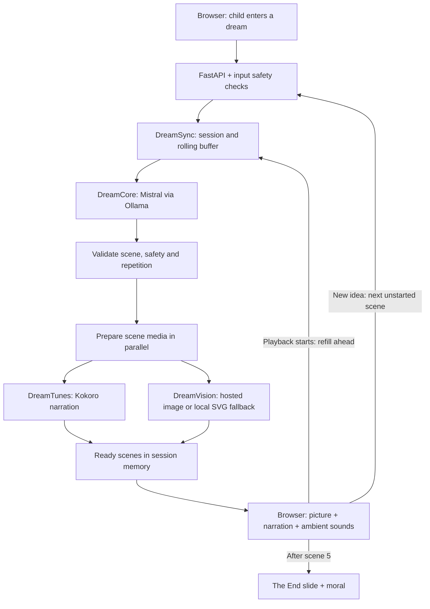

# DreamTales: interview guide

Verified against the local app and Ollama on October 12, 2026.

## Models and components

| Component | Current implementation | Role |
|---|---|---|
| DreamCore | Mistral 7B Instruct, Ollama tag mistral:7b-instruct | Plans a five-scene arc and generates short scenes with named characters and dialogue. |
| Story model runtime | Local Ollama, Q4_K_M quantization, 8,192-token context (reported by Ollama) | Runs the model on the development Mac. |
| DreamTunes | Kokoro v1.0 ONNX, af_heart voice by default, speed 0.88 | Produces local narration using a persistent CPU worker. |
| DreamVision — active | Procedural SVG renderer | Draws each scene from its characters, location and weather; this is not an image model. |
| DreamVision — integrated, inactive | OpenAI gpt-image-2 | Landscape picture-book image requests are implemented but need OPENAI_API_KEY. Live quality and latency are not yet verified. |
| Background sound | Browser Web Audio synthesis | Produces rain, wind, crickets and waves. No generative audio model. |
| Safety | Local rules and schema validation | Screens requests and scenes; not a trained moderation model or complete child-safety guarantee. |

## Simplified architecture

These are modules in one FastAPI application, not separately deployed microservices. Kokoro runs in a child process and Ollama is a separate local model server. Hosted images, when enabled, call OpenAI.

## 45-second explanation

“DreamTales is an interactive bedtime storyteller. The child gives us an idea, which we screen before generating a short, five-scene story. DreamCore uses a local language model to plan the arc and write each scene. DreamSync coordinates the work: it validates the text and prepares narration and images in parallel. We prepare the first two scenes before playback, then keep generating ahead while the child listens. The browser combines the scene image, Kokoro narration and synthesized background sounds. New ideas are added to the next scene that has not started generation. After scene five, we show a separate moral-of-the-story slide.”

## Explain the latency optimization

| Playback | Preparation target |
|---|---|
| Before playback | Scenes 1 and 2 ready |
| Scene 1 begins | Prepare through scene 3 |
| Scene 2 begins | Prepare through scene 4 |
| Scene 3 begins | Prepare through scene 5 |
| Scene 5 ends | Show moral slide; no sixth model call |

Text generation for the next scene can also overlap media generation for the current one. This hides latency when production keeps up with narration; it does not make inference itself faster. Initial buffering increases startup wait. When generation falls behind, playback waits rather than skipping a scene.

## Useful interview distinctions

- The five-scene limit bounds history and gives the story a clear ending. It is not context compression or a guarantee against overflow; model requests still include completed scenes.
- Child directions affect the next unstarted scene. A scene already being generated or prepared is not rewritten.
- One moral is randomly selected per story from 20 curated entries and retained across all scenes and retries. The five stages are introduction, problem, proposed solution, trying the solution, and success. The language model writes events intended to demonstrate the selected lesson.
- Repetition checks catch exact and closely reworded text, not every semantic repetition.
- Sessions, images, outline and prepared scenes are kept in memory. Narration WAVs are temporary local files. There is no database, account system, RAG pipeline or fine-tuning.
- Hosted images currently have a 60-second application deadline and local-art fallback. API credentials, model access, cost, image consistency and live latency remain to be verified.
- The prototype needs stronger semantic safety evaluation and broader story-quality testing before deployment for children.
